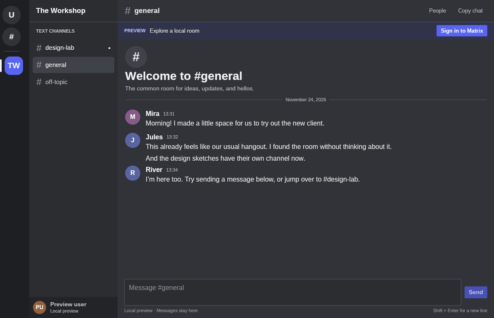

# Untethered

Untethered’s frontend is written in Rust using Iced. The Matrix engine is the
upstream [gomuks](https://github.com/gomuks/gomuks) project, written in Go.

See the [Discord-parity roadmap and milestone checks](ROADMAP.md).

## Desktop

Try the native Discord-style frontend from the checkout:

```sh
bash scripts/rust-client.sh       # Linux x86-64, current Rust toolchain and system GUI libraries
```

On x64 Windows with Rust and the MSVC build tools: `.\scripts\rust-client.ps1`.
Both launchers use gomuks **v0.2611.1** for Matrix and store this client's session in
`.dev/rust-profile`. Set `UNTETHERED_BACKEND`
and `UNTETHERED_PROFILE` to use another compatible binary and dedicated profile.

**How startup works:** The dev launcher fetches the pinned gomuks executable
on first use, verifies its SHA-256 and caches it in `.dev/backends/`. On every
launch, the Rust app locks the profile, starts `gomuks --desktop` as a child,
and reads its loopback address from stdout. It authenticates with a fresh
per-launch secret and opens a local WebSocket for Matrix commands and events.
Closing the app shuts down the child. There’s no separate service to start.

In Code OSS, **Ctrl+Shift+B** builds the Rust binary; **Terminal → Run Task →
untethered: Run** launches the desktop app.

The first launch opens a **local preview**: try the space rail, direct messages,
channel switching, People, Copy chat, or the composer (Enter sends, Shift+Enter adds
a line). Preview messages are never sent and disappear when you quit. Choose
**Sign in to Matrix** for live rooms. Enter a homeserver such as `matrix.org`;
the client adds `https://`. This prototype supports password login and verification
with the account’s existing recovery key (grouped or compact) or recovery passphrase.
The web verification form supports ordinary keyboard and context-menu paste.
SSO and first-time encryption setup aren’t implemented. Emoji comparison (SAS)
needs support from the client engine; the pinned gomuks release does not expose
that flow through its frontend API. Room sync, encryption, history, and sends use the upstream
gomuks engine. The UI currently renders plain text and initial-based avatars.

**Files:** Drop files onto a room or click **+** to stage them, optionally type
a caption for the first attachment, then press **Send**. A local preview strip
shows image thumbnails or file-type cards; use **×** to remove a file. PNG,
JPEG, GIF and WebP previews are static. Oversized or unsupported images still
send as ordinary attachments within the upload limit. Each file is a standard
Matrix media event. Draft attachments stay in their original room when you switch.
Uploads are sequential, with up to 10 staged files per room and a 64 MiB/file cap
(lower if the homeserver advertises a smaller limit). Click **Save** on a received
attachment. Preview mode simulates a send locally; it never uploads.

On native Wayland you can drop a URI list or a file-transfer portal offer
from a sandboxed app. Portal files stay bound to the room that received the
drop, even if you navigate away before the desktop portal responds. The app
holds a read-only handle to each selected file while it is staged.

During upload the card shows the transfer percentage and a **Cancel** button.
Cancel stops the active upload and pauses the batch, keeping the files and
caption in the original room. **Retry** resumes the unsent files; files already
confirmed in the room are not sent again. Once an attachment is sending its
room event, it can no longer be cancelled as an upload.

To send a screenshot, copy it and press **Ctrl+V in the message composer**.
An image becomes a removable PNG attachment; plain text is inserted at the cursor.
The image stays local until Send. Linux Wayland reads the focused clipboard
through the app's existing data device; no clipboard watcher or helper daemon is needed.

Received images show an inline thumbnail in the active conversation. The client
uses encrypted Matrix thumbnails when available, or decodes a small original
(up to 4 MiB) via gomuks. **Save** still downloads the original. The repeatable
`scripts/test-media-interop.py` test checks actual pixels in an independent browser
device after both login and reload against a disposable Synapse.

The [KWin/Element acceptance test](scripts/kwin-element.md) exercises a real
Dolphin multi-file drag, room switching during upload, and byte-for-byte PNG/PDF
downloads in both directions using the two clients’ visible controls.

**Linux DM calls (experimental):** Open an encrypted direct message with one
other joined user and click **Voice call**. Element rings; when the recipient
accepts, Untethered uses the default microphone and output through `pacat`
(PulseAudio or PipeWire-Pulse). **Hang up** releases both streams. Calling
needs a verified Matrix device and a homeserver advertising a LiveKit
`livekit_service_url` with OpenID authorization. Source builds need Clang for
the LiveKit SDK. **Account → Check call server support** queries the gomuks
transport-discovery RPC; legacy deployments can also advertise in `.well-known`.

With Untethered open, an incoming Element DM voice call plays a ringtone and
shows the caller, **Accept**, and **Decline**. Declining notifies Element
without opening your microphone. Accepting joins the existing encrypted call.
Either participant can hang up.

The call bar stays with the active DM while you browse other rooms. **Mute**
releases your microphone and leaves the other person audible. **Deafen**
silences playback and also mutes your microphone. **Undeafen** restores
playback and your previous mute setting.

Open **Devices** in the call bar to choose a **Microphone** and **Speaker**
independently. Each starts on **System default**. Switching affects only this
call, keeps its encrypted tracks connected, and preserves mute/deafen.
**Refresh devices** updates the list after plugging in or removing a device.

During a brief network interruption, the Linux call bar shows **Reconnecting**
and releases the audio devices. If both devices are still in the same Matrix
call when connectivity returns, encrypted audio resumes automatically. Once
membership has expired, starting another call requires a new **Voice call**.

If direct media is blocked, both clients can use the TURN relay advertised by
LiveKit. The [relay-only test](experiments/rtc-audio/README.md#verify-turn-only-calls)
verified encrypted audio with either Untethered or Element initiating.

The [desktop call tests](experiments/rtc-audio/README.md) drive both clients'
actual call controls and measure audio through isolated Linux devices.

**Linux voice rooms (experimental):** Open an existing encrypted Matrix call
room (`org.matrix.msc3417.call`, marked **♪**) and click **Join voice**.
People in voice appear under the room name. While you’re connected, a green
**Speaking** label appears beside each person talking, including you. It
clears when their microphone goes quiet. Joining never rings the other
members. **Leave voice** disconnects only your device; the others can keep
talking. The [three-person test](experiments/rtc-audio/README.md#verify-three-person-voice-rooms)
uses three Linux clients on the same MatrixRTC LiveKit service.
Room permissions must allow publishing call membership and, for the first
participant, opening the voice slot if it is not already open.

Open **Mixer** in the voice-room call bar to change how loud each person
sounds to you for this call. Drag their slider from **0%** (silent for you)
to **200%**, or click **Reset** to return to **100%**. Other listeners keep
their own mixes.

For **Push-to-talk**, check the box beside **Join voice** or in the call bar.
Hold **Right Ctrl** while Untethered is focused to send your voice. Releasing
the key or switching applications closes your microphone; you still hear
the room. **Mute** and **Deafen** override the key. The choice carries over
to your next voice room until you quit the app.

In the voice-room call bar, click **Share window** and pick a window in your
desktop's chooser. Other participants see the live window in the voice room.
You can browse another channel and use **Stop sharing** there without
leaving voice. Capture requires a ScreenCast portal backend, PipeWire and
GStreamer (`gst-launch-1.0`, `pipewiresrc`, and the base video plugins).
The share carries window pixels; microphones remain separate encrypted tracks.

**Start camera** uses the Linux Camera portal and the default camera on its
PipeWire connection. Other participants see a **Camera** tile with your name.
**Stop camera** releases capture and removes the tile while voice continues.
Camera and window sharing have independent controls and encrypted tracks.



## Browser

The browser runs the same Rust view and an embedded gomuks WebAssembly worker.
No desktop gomuks process or proxy is needed. Its Matrix device lives in the
browser's origin-private storage, independently of the desktop profile. Use a
modern browser at `localhost` or an HTTPS origin.

Only one tab can use the browser device at once. Another tab waits and connects
automatically when the active tab closes. If upgrading from an older build that
reported “worker stopped,” close the old tabs and reopen the same URL. Keep the
site data: that’s where the device’s encryption keys live.

```sh
rustup target add wasm32-unknown-unknown
# Requires Trunk, wasm-bindgen-cli matching Cargo.lock, Node/npm, Go and Git.
bash scripts/rust-web.sh
python3 -m http.server 8080 --bind 127.0.0.1 --directory rust-client/web/dist
```

Open `http://127.0.0.1:8080`. The build uses the pinned upstream Go worker and
SQLite bridge. The native transport, browser transport, room model and Iced view
are in `rust-client/src`. `cargo test --manifest-path rust-client/Cargo.toml`
runs the model regression test; the ignored live test requires a disposable
loopback homeserver, an encrypted room and an isolated profile.

## Arch Linux package (x86-64)

Run `makepkg -s` in the checkout to build the **current local Git commit**.
The package installs `/usr/bin/untethered` and `/usr/lib/untethered/gomuks`.
Launching `untethered` uses that bundled backend without a runtime download.
The packaged app keeps its Matrix device in `$XDG_DATA_HOME/untethered-iced`
(default `~/.local/share/untethered-iced`), separate from the development profile.
